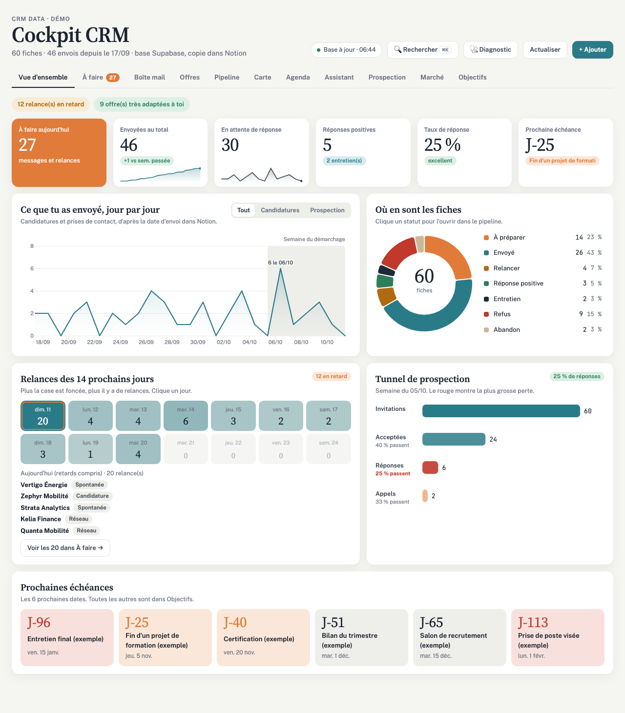
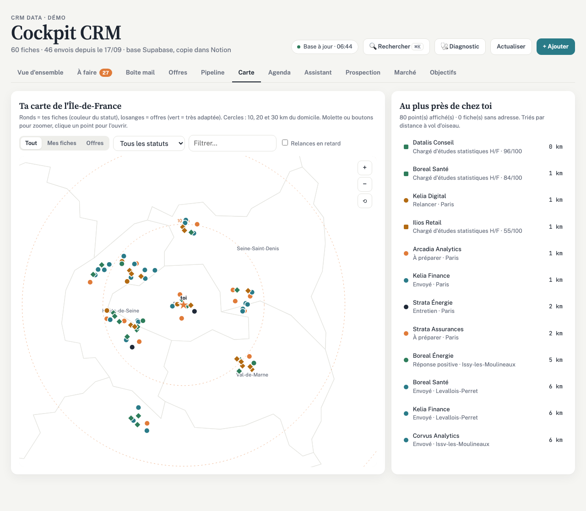
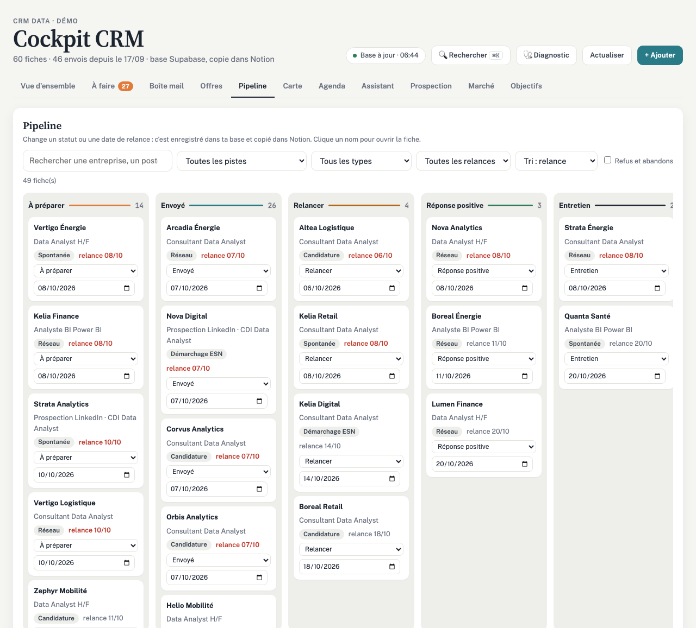
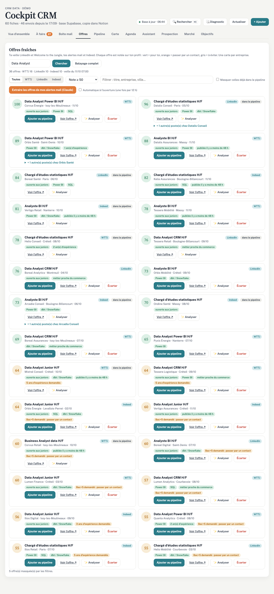

# 🗂️ CRM data et agents IA : centraliser offres, contacts et échanges


Plus de 120 entreprises et contacts du secteur data à suivre, des dizaines d'offres publiées chaque jour sur plusieurs sites, des échanges sur LinkedIn et par mail. J'ai construit un CRM qui rassemble tout au même endroit : **une base PostgreSQL alimentée par des API, du code planifié pour ce qui est prévisible, et des agents IA seulement là où il faut comprendre du texte.**



---

## 📖 Contexte

J'avais d'abord mesuré le marché de l'emploi data avec un pipeline Python ([job-market-pipeline](https://github.com/Heltondsm/job-market-pipeline) : 787 offres et 1 135 entreprises, API France Travail et INSEE Sirene). Restait à exploiter ces informations au quotidien.

Sans outil, elles se dispersent : une réponse reçue sur LinkedIn passe inaperçue, une relance part trop tard, une bonne offre se perd dans la masse. Le besoin : **une seule source de vérité**, à jour sans saisie manuelle, et une vue claire chaque matin.

---

## 🎯 Ce que j'ai fait

- Écrit le processus à la main et je l'ai fait tourner plusieurs semaines **avant** d'automatiser quoi que ce soit
- Modélisé une base **PostgreSQL** de 7 tables : fiches entreprises et contacts, offres, messages, relations, publications, indicateurs hebdomadaires, journal des traitements
- Écrit en **Python** la collecte de l'activité LinkedIn (API Member Data Portability), planifiée trois fois par jour avec **GitHub Actions**
- Rattaché automatiquement chaque message reçu à la bonne fiche : par le profil, puis par le prénom dans la conversation
- Géolocalisé chaque siège avec l'**API de l'annuaire des entreprises** pour les placer sur une carte
- Confié aux **agents IA (Claude)** les seules tâches de lecture : noter chaque offre sur 100 avec une grille écrite à l'avance, classer les mails reçus
- Construit une **application de pilotage** (JavaScript, d3.js) : vue d'ensemble, pipeline, carte, recherche globale

---

## 🏗️ Architecture

```
Sources (API LinkedIn, Gmail, sites d'offres)
        ↓
Code planifié (Python, GitHub Actions) : collecte, rapprochement, alertes
        ↓
Base PostgreSQL (Supabase) : fiches, offres, messages, historique
        ↓
Agents IA (Claude) : lire, noter, classer
        ↓
Moi : j'analyse, je décide, j'écris. Je mesure ce qui marche chaque semaine.
```

| Tâche | Qui la fait | Pourquoi |
|---|---|---|
| Collecter relations, messages et publications LinkedIn | Code Python planifié | Toujours la même règle : pas besoin d'IA |
| Rattacher un message à la bonne fiche | Code Python | Un rapprochement, pas une interprétation |
| Placer chaque entreprise sur la carte | Code Python + API publique | Une simple recherche |
| Lire une offre et la noter sur 100 | Agent IA | Il faut comprendre un texte libre |
| Classer un mail reçu | Agent IA | Idem |
| Décider, écrire et envoyer | Moi | Rien ne part sans ma relecture |

---

## 🔍 Ce que ça donne

### 1️⃣ Une vue claire chaque matin

Les relances du jour, les réponses à traiter et les meilleures offres, sans rien chercher. **2 168 relations LinkedIn analysées**, chaque échange rattaché à sa fiche.

### 2️⃣ Les entreprises sur une carte



Les sièges des entreprises et les offres sur l'Île-de-France, avec la distance au domicile et un filtre par statut.

### 3️⃣ Un pipeline qu'on pilote



Un tableau par statut, des filtres par date de relance, une fiche détaillée modifiable. Chaque changement est enregistré dans la base.

### 4️⃣ Les offres notées et regroupées



---

## 🧪 Choix techniques

- **PostgreSQL plutôt qu'un outil de notes** : au départ, tout était dans une base Notion. Lue toutes les cinq minutes par l'application et par les agents, elle a atteint sa limite de lectures en une soirée. Une vraie base règle le problème et permet d'écrire du SQL.
- **Lire seulement la fin du journal LinkedIn** : l'API a un plafond d'appels par jour. Les scripts ne lisent que la fin du journal, là où se trouvent les nouveautés.
- **Ne pas faire confiance à l'horaire des tâches planifiées** : GitHub lance parfois une tâche avec plusieurs heures de retard. La vérification passe donc plusieurs fois et ne fait rien quand il n'y a rien à faire.
- **Un journal pour chaque passage** : chaque script et chaque agent écrit ce qu'il a lu, traité ou raté. Une source en panne est signalée, jamais présentée comme une journée calme.
- **Sécurité** : aucune clé dans le code, clés dans les secrets GitHub, sécurité par ligne activée sur toutes les tables, et aucune donnée réelle publiée ici.

---

## 🛠️ Technologies utilisées

Python · PostgreSQL (Supabase) · SQL · GitHub Actions · API REST (LinkedIn, annuaire des entreprises) · JavaScript · d3.js · Claude Code (agents, connecteurs MCP)

---

## ▶️ Lancer la démo

Ouvrir `app/demo.html` dans un navigateur : l'application tourne sur **60 entreprises et 36 offres entièrement fictives** (connexion internet nécessaire pour d3.js). Pour régénérer les données :

```bash
python3 app/demo/generer_donnees.py
python3 app/demo/construire_demo.py
```

---

## 📂 Structure du dépôt

```
sql/schema.sql              le modèle de données (7 tables)
sentinelle/sentinelle.py    collecte LinkedIn, rapprochement des messages, alertes
publications/verifier.py    vérifie qu'une publication est sortie et ajoute le lien en commentaire
app/cockpit.html            l'application de pilotage
app/demo.html               la même application sur données fictives
app/demo/                   génération des données fictives
agents/                     rôle de chaque agent IA et modèle de consignes
captures/                   vue d'ensemble, carte, pipeline, offres
```

---

## 📈 Compétences démontrées

### Données
- ✅ Modèle relationnel PostgreSQL pensé pour l'usage : index sur les statuts et les dates de relance, clés uniques contre les doublons
- ✅ Collecte par API REST avec gestion des quotas et reprise là où le dernier passage s'est arrêté
- ✅ Rapprochement automatique de sources différentes (messages, relations, fiches)

### Automatisation et IA
- ✅ Traitements planifiés avec GitHub Actions, clés dans les secrets
- ✅ Partage du travail entre code déterministe et IA, justifié tâche par tâche
- ✅ Agents IA encadrés : consignes écrites, garde-fous, journal de chaque passage

### Restitution
- ✅ Application de pilotage : indicateurs, pipeline, carte, recherche globale
- ✅ Mesure chaque semaine de ce qui marche, et contrôle de la note des offres face aux décisions réelles

---

## 📧 Contact

**Helton Dos Santos Moreira**
Data Analyst / Data Engineer | 10 ans d'expérience business (retail et e-commerce)

- 📧 Email : heltonmail8@gmail.com
- 💼 LinkedIn : [in/helton-dsm-data](https://linkedin.com/in/helton-dsm-data)
- 🌐 Portfolio : [heltondsm.github.io](https://heltondsm.github.io/)

---

## 🔗 Autres projets

- [Pipeline de veille du marché de l'emploi](https://github.com/Heltondsm/job-market-pipeline), APIs France Travail et INSEE Sirene, 787 offres et 1 135 entreprises en 14 secondes
- [Portefeuille de 104 projets dans 52 pays](https://github.com/Heltondsm/powerbi-portefeuille-projets-rls), Power BI, sécurité au niveau des lignes sur 3 rôles
- [Pipeline dbt : profils sociodémographiques](https://github.com/Heltondsm/dbt-demographics-pipeline), Snowflake et DuckDB, 26 tests, reproductible en une commande
- [Aide à la décision pour une ONG de l'eau potable](https://github.com/Heltondsm/powerbi-aide-decision-eau-potable), Power BI, schéma en constellation, seuil de stabilité réglable

---

**Projet réalisé en octobre 2026**
